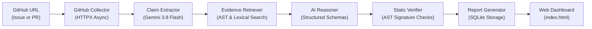

# IssueTrace — Every claim has a trail. Follow the evidence. 🔍

> **AI-Powered GitHub Issue Intelligence Platform**  
> Investigates technical claims using real repository evidence, AST code structures, tests, and Gemini 3.8 Flash.

[](https://python.org)
[](https://fastapi.tiangolo.com)
[](https://aistudio.google.com)
[]()

---

## 🎯 What is IssueTrace?

Open-source maintainers face overwhelming volumes of bug reports, feature requests, and pull requests—many of which contain invalid technical assumptions, hallucinations, regressions, or unreproducible claims.

Instead of a generic chatbot, **IssueTrace** acts as a technical investigation tool:
1. **Retrieves** GitHub issue / PR details, file trees, commit metadata, tests, and documentation.
2. **Extracts** discrete atomic technical claims with expected vs. reported behavior.
3. **Gathers** concrete evidence (source lines, AST function definitions, test suites, docstrings).
4. **Reasons** over evidence using **Google Gemini 3.8 Flash** with Pydantic structured schemas.
5. **Performs safe static verification** (Python AST signature checks, test discovery, location existence).
6. **Produces a structured triage report** with categorized verdicts (`CONFIRMED`, `INVALID`, `CANNOT_REPRODUCE`), confidence estimates, and maintainer action plans.

---

## 🚀 Quick Start (Open in Browser)

### Option 1: Direct Browser Opening (Zero Setup)
Simply open the included `index.html` in any web browser:
- Double-click **`index.html`** in this project folder, or open in Chrome/Safari/Firefox.

The UI loads immediately with full dashboard capabilities, claim exploration, evidence inspection, and 1-click test cases.

---

### Option 2: Running the FastAPI Backend

```bash
# 1. Navigate to backend directory
cd backend

# 2. Activate virtual environment
source venv/bin/activate

# 3. (Optional) Configure Gemini API key for live AI reasoning in .env
cp .env.example .env
# Edit .env and set GEMINI_API_KEY=your_key_here

# 4. Start backend server
uvicorn app.main:app --reload --port 8000
```

Once running:
- **Interactive Web App**: [http://localhost:8000/](http://localhost:8000/) or [http://localhost:8000/app](http://localhost:8000/app)
- **Interactive Swagger API Docs**: [http://localhost:8000/docs](http://localhost:8000/docs)
- **API Health Endpoint**: [http://localhost:8000/api/health](http://localhost:8000/api/health)

---

## 🧪 Running Tests

The test suite contains **78 automated tests** covering URL parsing, AST code inspection, evidence retrieval, AI response validation, and SQLite persistence:

```bash
cd backend
source venv/bin/activate
pytest tests/ -v
```

All 78 unit and integration tests run in **< 0.5s** with 100% mocked external calls (no API keys required).

---

## 🏗️ Architecture Overview



### Safety & Operational Safeguards
- **No Arbitrary Code Execution**: No untrusted contributor code is executed on the server.
- **Untrusted Input Isolation**: All issue text and repository code are treated as untrusted data with strict prompt boundaries.
- **Graceful Degradation**: App starts and runs with or without a Gemini API key.

---

## 📊 Benchmark Evaluation

Run the evaluation script against ground truth labeled issues:
```bash
python backend/evaluation/evaluate.py
```
Outputs accuracy, per-class precision, recall, and confusion matrix.
